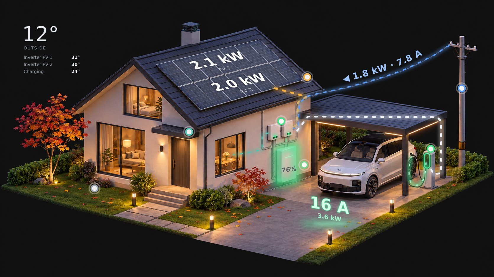

# MF Home Monitor

**English** · [Русский](README.ru.md) · [中文](README.zh.md)

Home Assistant cards for a solar home with a battery and an EV charger. A rendered house shows live
energy flows, panel power, battery state, charging current and temperatures. Tap a dot on any object for details.



## Cards

| Card | What it shows |
|---|---|
| `custom:mf-house-card` | The house: energy flows (solar, grid, battery, home, EV), power of each panel row, grid power and current above the wire, battery SOC with a green/red pulse, charger ring and cable, current on the ground while charging, temperatures, tap-to-open info plates, full-screen mode on phones |
| `custom:mf-now-card` | Solar and home power, grid bar with limit, battery bar with thresholds |
| `custom:mf-badges-card` | A row of large badges, e.g. energy today |
| `custom:mf-day-chart` | Power today: solar, EV, consumption, grid, SOC |
| `custom:mf-days-chart` | Energy per day: solar, consumption, from grid, to the EV |

The picture changes by itself: day / night (`sun.sun`), rain, snow (by month or by temperature while it rains),
and the car disappears when it is not plugged in. 12 renders are included.

Languages: English, Russian, Chinese — taken from your HA profile or set with `language:`.

## Installation

### HACS
1. HACS → ⋮ → **Custom repositories** → `https://github.com/mfkilla13/mf-home-monitor`, type **Dashboard**.
2. Install **MF Home Monitor** and reload the browser.

### Manual
1. Copy `dist/mf-home-monitor.js` to `/config/www/mf-home-monitor/`.
2. Settings → Dashboards → ⋮ → **Resources** → add `/local/mf-home-monitor/mf-home-monitor.js` as **JavaScript module**.

### Pictures
Copy all files from [`images/`](images) to `/config/www/mf-home-monitor/`. HACS does not copy them.

## Configuration

A complete example is in [`examples/dashboard.yaml`](examples/dashboard.yaml).

```yaml
type: custom:mf-house-card
frameless: true
no_car_images: true
image_night: /local/mf-home-monitor/house_night.jpg
image_day: /local/mf-home-monitor/house_day.jpg
entities:
  pv: sensor.pv_power
  grid: sensor.grid_power
  battery: sensor.battery_power
  soc: sensor.battery_soc
  home: sensor.home_power
  ev: sensor.ev_charger_power
  charger: switch.ev_charger
  charger_status: sensor.ev_charger_status
```

Every entity is optional: anything you leave out hides the related layer, dot or row.

### Entities

| Key | Unit | Used for |
|---|---|---|
| `pv`, `pv1`, `pv2` | W | Total solar, upper and lower panel rows |
| `grid`, `grid_voltage` | W, V | Grid power (+ import / − export), amps above the wire |
| `grid_export` | W | Optional: separate export sensor (≥ 0) if your grid sensor shows import only |
| `battery`, `soc`, `voltage` | W, %, V | Battery power (+ charge / − discharge), SOC, voltage |
| `home`, `load` | W | Home without the EV; total load for the day chart |
| `ev`, `charger`, `charger_status`, `charger_current`, `charger_temp` | W, –, –, A, °C | EV charger. Status values: `charging`, `available`, `charged`, `waiting`, `fault` |
| `yield`, `consumption`, `import`, `ev_today`, `charge_today`, `discharge_today` | kWh | Daily counters (reset at midnight) |
| `peak` | W | Peak solar today |
| `t1`, `t2`, `bat_tmin`, `bat_tmax` | °C | Inverter and battery cell temperatures |
| `weather`, `outdoor_temp`, `lux`, `rain` | – | Outdoor temperature, illuminance, rain (rain also switches the picture) |
| `data_fresh`, `auto`, `ev_mode`, `ev_state` | – | Optional: inverter data OK, EV automation state |

### House card options

| Option | Default | Meaning |
|---|---|---|
| `image_night`, `image_day`, `image_winter_*`, `image_rain_*` | — | Pictures; a missing one falls back to the closest available |
| `no_car_images` | `false` | Car not plugged in → same file with `_nocar` suffix |
| `invert_battery` | `false` | Your battery sensor is + discharge / − charge |
| `invert_grid` | `false` | Your grid sensor is + export / − import |
| `charger_states` | built-in | Map your charger's status values, see below |
| `winter_months` | `[12, 1, 2]` | Months with winter pictures |
| `snow_below` | `1` | While it rains: at or below this °C — snow pictures |
| `frameless` | `false` | No card background — for pictures with the page background (`#111111`) |
| `fit_offset` | `170` | Desktop: px taken by everything above/below, so the picture fits the screen |
| `grid_red_amps` | `16` | Grid label and dot turn red above this current |
| `nominal_voltage` | `230` | Used when `grid_voltage` is missing |
| `panel_max_w` | `2800` | Panel row power for full glow |
| `pv_names` | `["PV 1", "PV 2"]` | Names of panel rows / inverters |
| `car_name` | `Car` | Title of the car plate |
| `show_home_text` | `true` | Home consumption in front of the door |
| `show_temperatures` | `true` | Temperature block in the corner |
| `phone_crop` | on | `false` — show the full picture on phones |
| `language` | HA profile | `en`, `ru`, `zh` |
| `layout` | shipped pictures | Coordinates of all layers, see below |
| `calibrate` | `false` | Layout wizard for your own picture |

## Other inverters and chargers

The cards work with any integration — they only read entity states. The defaults expect:

- **battery** `+` while charging, `−` while discharging → otherwise `invert_battery: true`;
- **grid** `+` import, `−` export → otherwise `invert_grid: true`, or add a separate `grid_export` sensor.
  Export is drawn as a green flow from the house to the pole with `▶` above the wire;
- **charger status** `charging`, `available` (no car), `waiting` (plugged in), `charged`, `fault`.
  Common values (`Disconnected`, `Connected`, `Charging`, `Complete`, `Error`, …) are recognized automatically;
  anything else — map it:
  ```yaml
  charger_states:
    charging: [Lädt]
    available: [Frei, "No car"]
    waiting: [Verbunden]
  ```
  `charger_states`, `invert_battery`, `invert_grid` go to every MF card that shows these values (house, now, day chart);
- **daily counters** that reset at midnight for `mf-days-chart`. Lifetime counters → `total_counters: true`
  (or a list of keys, e.g. `[yield, import]`);
- **panel rows**: any number — list them under `layout.panels`, each with its own `entity` key, and name them with `pv_names`.

## Your own house picture

1. **Generate the pictures** — ready prompts for ChatGPT / Gemini: [docs/PROMPTS.md](docs/PROMPTS.md).
   You need a base render and variants of the same render (day, winter, rain, without the car).
2. Copy them to `/config/www/mf-home-monitor/` and set them in the card.
3. Add `calibrate: true` to the card. A **layout wizard** appears under the picture and goes through 24 steps:
   dots on every object, the two panel rows (4 corners each), flows along the pipes and the wire, battery cabinet,
   charger ring, charging cable, where to put the current label and temperatures, phone crop.
   Tap the picture; every mark is drawn at once and the layers move there live. Steps you don't need — **Skip**.
   Progress is kept in the browser, so you can close the page and continue later.
4. Press **Copy YAML**, paste the `layout:` block into the card config and remove `calibrate: true`.

The picture size is taken from the file automatically; all keys and defaults are in `DEFAULT_LAYOUT`
at the top of `dist/mf-home-monitor.js`.

## License

- Code: [MIT](LICENSE) — keep the copyright notice with the author's name in copies.
- Pictures: [CC BY 4.0](images/LICENSE.md) — credit the author when you use them.

© 2026 Alexandru Volovoi (mfkilla13)
