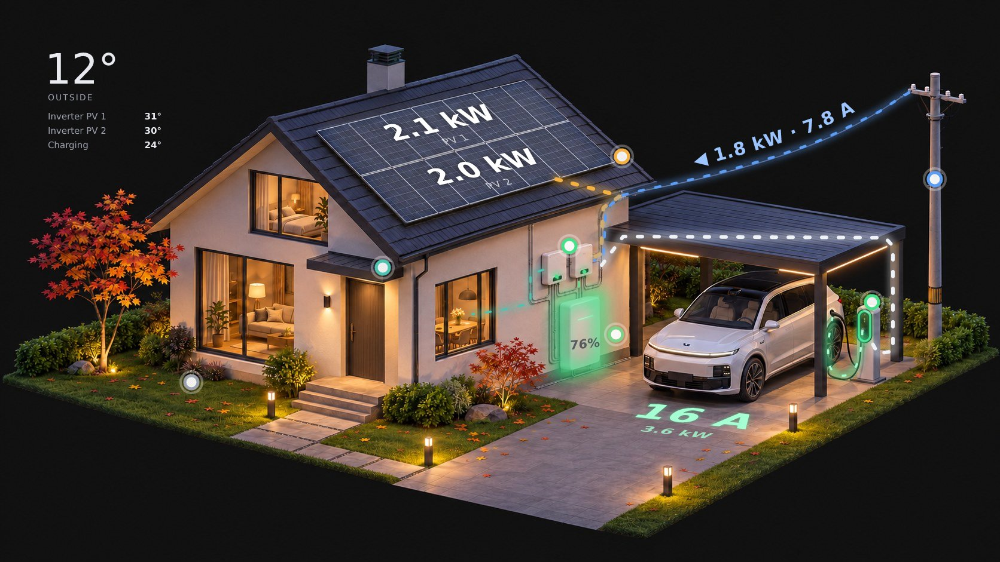

# MF Home Monitor

[English](README.md) · **Русский** · [中文](README.zh.md)

Карточки Home Assistant для дома с солнечными панелями, батареей и зарядкой электромобиля. На рендере дома
в реальном времени видны потоки энергии, мощность панелей, состояние батареи, ток зарядки и температуры.
Нажмите на точку на любом объекте, чтобы увидеть подробности.



## Карточки

| Карточка | Что показывает |
|---|---|
| `custom:mf-house-card` | Дом: потоки энергии (солнце, сеть, батарея, дом, машина), мощность каждого ряда панелей, мощность и ток сети над проводом, SOC батареи с зелёной/красной пульсацией, кольцо и кабель зарядки, ток на земле во время зарядки, температуры, плашки по нажатию, полноэкранный режим на телефоне |
| `custom:mf-now-card` | Мощность солнца и дома, полоса сети с лимитом, полоса батареи с порогами |
| `custom:mf-badges-card` | Строка крупных плашек, например энергия за сегодня |
| `custom:mf-day-chart` | Мощность за сегодня: солнце, машина, потребление, сеть, SOC |
| `custom:mf-days-chart` | Энергия по дням: солнце, потребление, из сети, в машину |

Картинка меняется сама: день / ночь (`sun.sun`), дождь, снег (по месяцам или по температуре во время осадков),
а машина исчезает, когда не подключена к зарядке. В комплекте 12 рендеров.

Языки: английский, русский, китайский — по профилю HA или параметру `language:`.

## Установка

### HACS
1. HACS → ⋮ → **Пользовательские репозитории** → `https://github.com/mfkilla13/mf-home-monitor`, тип **Dashboard**.
2. Установите **MF Home Monitor** и обновите страницу браузера.

### Вручную
1. Скопируйте `dist/mf-home-monitor.js` в `/config/www/mf-home-monitor/`.
2. Настройки → Панели → ⋮ → **Ресурсы** → добавьте `/local/mf-home-monitor/mf-home-monitor.js` как **модуль JavaScript**.

### Картинки
Скопируйте все файлы из [`images/`](images) в `/config/www/mf-home-monitor/`. HACS их не копирует.

## Настройка

Полный пример — в [`examples/dashboard.yaml`](examples/dashboard.yaml).

```yaml
type: custom:mf-house-card
frameless: true
no_car_images: true
image_night: /local/mf-home-monitor/house_night.jpg
image_day: /local/mf-home-monitor/house_day.jpg
entities:
  pv: sensor.pv_power
  grid: sensor.grid_power
  battery: sensor.battery_power
  soc: sensor.battery_soc
  home: sensor.home_power
  ev: sensor.ev_charger_power
  charger: switch.ev_charger
  charger_status: sensor.ev_charger_status
```

Все сущности необязательны: то, что не указано, просто не показывается (слой, точка или строка).

### Сущности

| Ключ | Единицы | Для чего |
|---|---|---|
| `pv`, `pv1`, `pv2` | W | Солнце всего, верхний и нижний ряд панелей |
| `grid`, `grid_voltage` | W, V | Импорт из сети, ток над проводом |
| `battery`, `soc`, `voltage` | W, %, V | Мощность батареи (+ заряд / − разряд), SOC, напряжение |
| `home`, `load` | W | Дом без машины; вся нагрузка для графика дня |
| `ev`, `charger`, `charger_status`, `charger_current`, `charger_temp` | W, –, –, A, °C | Зарядка. Статусы: `charging`, `available`, `charged`, `waiting`, `fault` |
| `yield`, `consumption`, `import`, `ev_today`, `charge_today`, `discharge_today` | kWh | Суточные счётчики (сброс в полночь) |
| `peak` | W | Пик солнца за сегодня |
| `t1`, `t2`, `bat_tmin`, `bat_tmax` | °C | Температуры инверторов и ячеек батареи |
| `weather`, `outdoor_temp`, `lux`, `rain` | – | Температура на улице, освещённость, дождь (дождь также переключает картинку) |
| `data_fresh`, `auto`, `ev_mode`, `ev_state` | – | Необязательно: данные инвертора в порядке, состояние автоматики зарядки |

### Параметры карточки дома

| Параметр | По умолчанию | Что делает |
|---|---|---|
| `image_night`, `image_day`, `image_winter_*`, `image_rain_*` | — | Картинки; если нужной нет, берётся ближайшая из заданных |
| `no_car_images` | `false` | Машина не подключена → тот же файл с суффиксом `_nocar` |
| `winter_months` | `[12, 1, 2]` | Месяцы с зимними картинками |
| `snow_below` | `1` | Во время осадков: при этой °C и ниже — снег |
| `frameless` | `false` | Без фона карточки — для картинок с фоном страницы (`#111111`) |
| `fit_offset` | `170` | ПК: сколько px занято выше и ниже, чтобы картинка влезла в экран |
| `grid_red_amps` | `16` | Подпись и точка сети краснеют выше этого тока |
| `nominal_voltage` | `230` | Если нет `grid_voltage` |
| `panel_max_w` | `2800` | Мощность ряда панелей для полного свечения |
| `pv_names` | `["PV 1", "PV 2"]` | Названия рядов панелей / инверторов |
| `car_name` | `Машина` | Заголовок плашки машины |
| `show_temperatures` | `true` | Блок температур в углу |
| `phone_crop` | вкл | `false` — на телефоне показывать картинку целиком |
| `language` | профиль HA | `en`, `ru`, `zh` |
| `layout` | под картинки из комплекта | Координаты всех слоёв, см. ниже |
| `calibrate` | `false` | Мастер разметки своей картинки |

## Своя картинка дома

1. **Сгенерируйте картинки** — готовые промпты для ChatGPT / Gemini: [docs/PROMPTS.ru.md](docs/PROMPTS.ru.md).
   Нужен базовый рендер и варианты этого же рендера (день, зима, дождь, без машины).
2. Скопируйте их в `/config/www/mf-home-monitor/` и укажите в карточке.
3. Добавьте в карточку `calibrate: true`. Под картинкой появится **мастер разметки** из 24 шагов:
   точки на каждом объекте, два ряда панелей (по 4 угла), потоки по трубам и проводу, шкаф батареи,
   кольцо станции, кабель зарядки, где ставить надпись тока и температуры, кадр для телефона.
   Нажимайте на картинку: каждая отметка сразу рисуется, а слои сразу переезжают туда. Ненужные шаги — **Пропустить**.
   Прогресс сохраняется в браузере: можно закрыть страницу и продолжить позже.
4. Нажмите **Скопировать YAML**, вставьте блок `layout:` в настройки карточки и уберите `calibrate: true`.

Размер картинки берётся из файла сам; все ключи и значения по умолчанию — в `DEFAULT_LAYOUT`
в начале `dist/mf-home-monitor.js`.

## Лицензия

- Код: [MIT](LICENSE) — в копиях нужно сохранять уведомление об авторских правах с именем автора.
- Картинки: [CC BY 4.0](images/LICENSE.md) — при использовании укажите автора.

© 2026 Alexandru Volovoi (mfkilla13)
