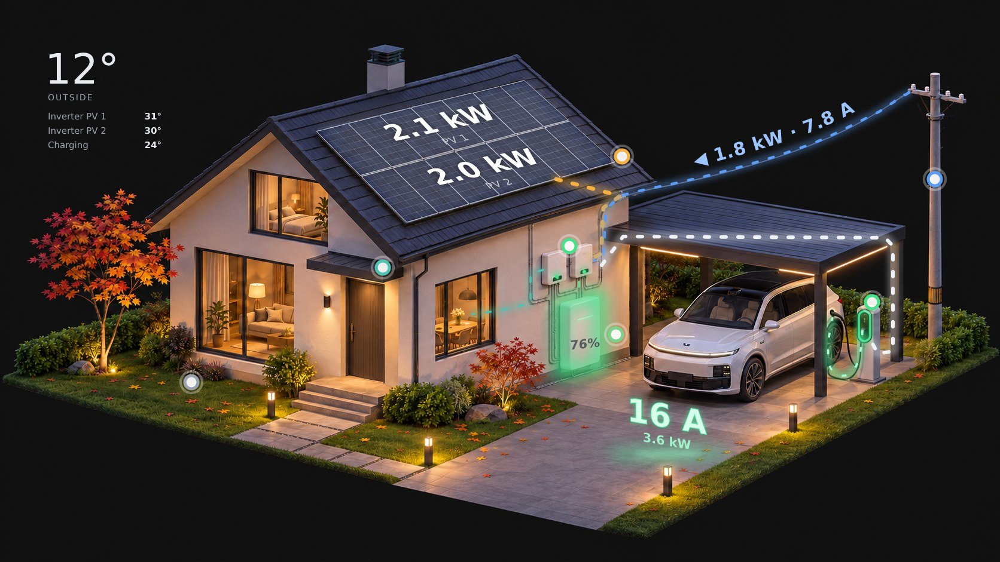

# MF Home Monitor

[English](README.md) · [Русский](README.ru.md) · **中文**

适用于带光伏板、储能电池和电动汽车充电桩住宅的 Home Assistant 卡片。住宅渲染图实时显示能量流向、
光伏功率、电池状态、充电电流和温度。点击任意设备上的圆点即可查看详情。



## 卡片

| 卡片 | 显示内容 |
|---|---|
| `custom:mf-house-card` | 住宅：能量流向（光伏、电网、电池、住宅、汽车）、每排光伏板功率、电线上方的电网功率和电流、带绿/红脉冲的电池 SOC、充电桩指示环和充电线、充电时地面上的电流、温度、点击弹出信息框、手机全屏模式 |
| `custom:mf-now-card` | 光伏和住宅功率、带限值的电网条、带阈值的电池条 |
| `custom:mf-badges-card` | 一行大号徽章，例如今日电量 |
| `custom:mf-day-chart` | 今日功率：光伏、汽车、用电、电网、SOC |
| `custom:mf-days-chart` | 每日电量：光伏、用电、来自电网、充入汽车 |

图片会自动切换：白天 / 夜晚（`sun.sun`）、下雨、下雪（按月份，或降水时按温度），汽车未连接充电桩时会消失。
附带 12 张渲染图。

语言：英语、俄语、中文 —— 取自 HA 用户资料，或通过 `language:` 设置。

## 安装

### HACS
1. HACS → ⋮ → **自定义存储库** → `https://github.com/mfkilla13/mf-home-monitor`，类型 **Dashboard**。
2. 安装 **MF Home Monitor** 并刷新浏览器。

### 手动安装
1. 将 `dist/mf-home-monitor.js` 复制到 `/config/www/mf-home-monitor/`。
2. 设置 → 仪表盘 → ⋮ → **资源** → 添加 `/local/mf-home-monitor/mf-home-monitor.js`，类型 **JavaScript 模块**。

### 图片
将 [`images/`](images) 中的所有文件复制到 `/config/www/mf-home-monitor/`。HACS 不会复制它们。

## 配置

完整示例见 [`examples/dashboard.yaml`](examples/dashboard.yaml)。

```yaml
type: custom:mf-house-card
frameless: true
no_car_images: true
image_night: /local/mf-home-monitor/house_night.jpg
image_day: /local/mf-home-monitor/house_day.jpg
entities:
  pv: sensor.pv_power
  grid: sensor.grid_power
  battery: sensor.battery_power
  soc: sensor.battery_soc
  home: sensor.home_power
  ev: sensor.ev_charger_power
  charger: switch.ev_charger
  charger_status: sensor.ev_charger_status
```

所有实体都是可选的：未填写的实体对应的图层、圆点或行不会显示。

### 实体

| 键 | 单位 | 用途 |
|---|---|---|
| `pv`, `pv1`, `pv2` | W | 光伏总功率、上排和下排光伏板 |
| `grid`, `grid_voltage` | W, V | 电网功率（+ 购电 / − 上网）、电线上方的电流 |
| `grid_export` | W | 可选：若电网传感器只显示购电，可单独提供上网功率传感器（≥ 0） |
| `battery`, `soc`, `voltage` | W, %, V | 电池功率（+ 充电 / − 放电）、SOC、电压 |
| `home`, `load` | W | 不含汽车的住宅功率；日图表的总负载 |
| `ev`, `charger`, `charger_status`, `charger_current`, `charger_temp` | W, –, –, A, °C | 充电桩。状态值：`charging`、`available`、`charged`、`waiting`、`fault` |
| `yield`, `consumption`, `import`, `ev_today`, `charge_today`, `discharge_today` | kWh | 每日计数器（午夜清零） |
| `peak` | W | 今日光伏峰值 |
| `t1`, `t2`, `bat_tmin`, `bat_tmax` | °C | 逆变器和电池单体温度 |
| `weather`, `outdoor_temp`, `lux`, `rain` | – | 室外温度、照度、降雨（降雨也会切换图片） |
| `data_fresh`, `auto`, `ev_mode`, `ev_state` | – | 可选：逆变器数据正常、充电自动化状态 |

### 住宅卡片选项

| 选项 | 默认值 | 说明 |
|---|---|---|
| `image_night`, `image_day`, `image_winter_*`, `image_rain_*` | — | 图片；缺少的会使用最接近的一张 |
| `no_car_images` | `false` | 汽车未连接 → 使用带 `_nocar` 后缀的同名文件 |
| `invert_battery` | `false` | 电池传感器为 + 放电 / − 充电 |
| `invert_grid` | `false` | 电网传感器为 + 上网 / − 购电 |
| `charger_states` | 内置 | 映射自己充电桩的状态值，见下文 |
| `winter_months` | `[12, 1, 2]` | 使用冬季图片的月份 |
| `snow_below` | `1` | 降水时：等于或低于此温度（°C）显示雪景 |
| `frameless` | `false` | 无卡片背景 —— 适用于背景与页面相同（`#111111`）的图片 |
| `fit_offset` | `170` | 电脑端：图片上下其他内容占用的像素，使图片完整显示在屏幕中 |
| `grid_red_amps` | `16` | 电流超过此值时电网标签和圆点变红 |
| `nominal_voltage` | `230` | 缺少 `grid_voltage` 时使用 |
| `panel_max_w` | `2800` | 光伏板一排达到满亮度的功率 |
| `pv_names` | `["PV 1", "PV 2"]` | 光伏板排 / 逆变器名称 |
| `car_name` | `汽车` | 汽车信息框标题 |
| `show_temperatures` | `true` | 角落里的温度区块 |
| `phone_crop` | 开 | `false` —— 手机上显示完整图片 |
| `language` | HA 用户资料 | `en`、`ru`、`zh` |
| `layout` | 附带图片的坐标 | 所有图层的坐标，见下文 |
| `calibrate` | `false` | 自有图片的布局向导 |

## 其他逆变器和充电桩

卡片适用于任何集成 —— 只读取实体状态。默认约定：

- **电池** 充电为 `+`，放电为 `−` → 否则设置 `invert_battery: true`；
- **电网** 购电为 `+`，上网为 `−` → 否则设置 `invert_grid: true`，或添加单独的 `grid_export` 传感器。
  上网会显示为从住宅流向电线杆的绿色能量流，电线上方带 `▶`；
- **充电桩状态** `charging`、`available`（无车）、`waiting`（已连接）、`charged`、`fault`。
  常见取值（`Disconnected`、`Connected`、`Charging`、`Complete`、`Error` 等）会自动识别；其他取值请映射：
  ```yaml
  charger_states:
    charging: [Lädt]
    available: [Frei, "No car"]
    waiting: [Verbunden]
  ```
  `charger_states`、`invert_battery`、`invert_grid` 需写入每张显示这些数值的 MF 卡片（住宅、当前、日图表）；
- `mf-days-chart` 默认使用午夜清零的**每日计数器**。累计计数器 → `total_counters: true`
  （或键列表，例如 `[yield, import]`）；
- **光伏板排数** 不限：在 `layout.panels` 中逐一列出，每排有自己的 `entity` 键，名称写在 `pv_names` 中。

## 使用自己的住宅图片

1. **生成图片** —— ChatGPT / Gemini 现成提示词：[docs/PROMPTS.zh.md](docs/PROMPTS.zh.md)。
   需要一张基础渲染图以及同一张图的多个版本（白天、冬季、雨天、无车）。
2. 将图片复制到 `/config/www/mf-home-monitor/` 并在卡片中设置。
3. 在卡片中添加 `calibrate: true`。图片下方会出现包含 24 个步骤的**布局向导**：
   每个设备上的圆点、两排光伏板（各 4 个角）、沿管线和电线的能量流、电池柜、充电桩灯环、充电线、
   电流标签和温度的位置、手机裁剪区域。点击图片，每个标记立即显示，图层也会实时移动到该位置。不需要的步骤点**跳过**。
   进度保存在浏览器中，可以关闭页面稍后继续。
4. 点击**复制 YAML**，将 `layout:` 区块粘贴到卡片配置中，然后删除 `calibrate: true`。

图片尺寸会自动从文件读取；所有键及默认值见 `dist/mf-home-monitor.js` 开头的 `DEFAULT_LAYOUT`。

## 许可证

- 代码：[MIT](LICENSE) —— 副本中须保留含作者姓名的版权声明。
- 图片：[CC BY 4.0](images/LICENSE.md) —— 使用时请注明作者。

© 2026 Alexandru Volovoi (mfkilla13)
